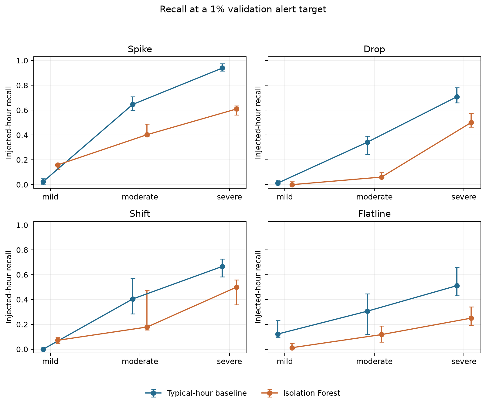

# Traffic Data Anomaly Detection and Reliability Assessment

Can a simple rule based on the usual traffic for an hour compete with an anomaly detection model?
This project compares a weekday/hour baseline with Isolation Forest using hourly traffic counts
from the UCI Metro Interstate Traffic Volume dataset.

The study introduces known changes into copies of later observations, then measures what each
method finds. It is a small, reproducible example of building an anomaly detection experiment:
auditing data, separating time periods, setting alert thresholds and interpreting imperfect results.

## Run the study

Install [uv](https://docs.astral.sh/uv/getting-started/installation/), then clone this repository
or download and extract its ZIP. Open a terminal in the folder containing this README and run:

```bash
uv sync --locked
uv run traffic-study all
uv run pytest -q
```

The commands work in a terminal or PowerShell. The project selects Python 3.14 and records package
versions in `uv.lock`; uv can install the required Python version. Setup creates a local `.venv`
directory. No environment activation is needed when using `uv run`.

The original dataset is included with attribution, so the study can run offline once its packages
are installed. If the raw files are absent, the preparation step downloads them from UCI.
Evaluation can take several minutes. When it finishes, open `reports/RESULTS.md` and `reports/figures/`.

Prefer to see what happens at each stage? Follow [Getting started](docs/getting-started.md).

## What is included

- A data audit that checks repeated timestamps, conflicting counts and missing hours.
- Chronological training, validation and test sets.
- A typical-hour median/MAD baseline and a 200-tree Isolation Forest.
- Four injected anomaly families: spikes, drops, sustained shifts and flatlines.
- 85 paired scenarios, four alert thresholds and separate model-seed checks.
- Detection metrics, change logs, six charts and a generated report.
- Four notebooks that explain the data, methods, experiments and results.
- Automated tests and a GitHub Actions workflow for the test suite.

## Results at a glance

These are median changed-hour recall values across five injection seeds, for the severe recipes
at the 1% validation alert target. Recall is the fraction of deliberately changed hours flagged.

| Change | Typical-hour baseline | Isolation Forest |
| --- | ---: | ---: |
| Spike | 93.9% | 61.0% |
| Drop | 70.7% | 50.0% |
| Shift | 66.7% | 50.0% |
| Flatline | 51.1% | 25.0% |



The baseline has higher recall for these severe recipes. Isolation Forest has higher median recall
for mild spikes and mild shifts. On unchanged test data, the background alert rates are 1.16% and
0.99%, respectively. See the [reference results](reports/reference/RESULTS.md) for the full comparison.

The source has no verified incident labels. Finding an injected change does not establish that a
detector can identify a real accident or sensor fault. The experiment covers one traffic station,
one historical split and the settings recorded in `configs/study.json`.

## Explore the notebooks

After running the study:

```bash
uv run jupyter lab
```

Open the `notebooks` folder and work through files 01–04. Use **Python 3 (ipykernel)** and run cells
from top to bottom with **Shift+Enter**. Notebook outputs are intentionally cleared in the repository;
running a cell produces its output in the current session.

## Find your way around

| Location | Contents |
| --- | --- |
| `configs/` | The experiment settings |
| `data/` | Original data, attribution and generated splits |
| `src/traffic_anomaly/` | Reusable data, model and evaluation code |
| `notebooks/` | Worked examples and exercises |
| `scripts/` | Stage runners and verification tools |
| `tests/` | Tests for the important correctness rules |
| `reports/reference/` | Published example results and charts |
| `docs/` | Setup, methods, file map and reproducibility notes |

Start with [the setup guide](docs/getting-started.md), then read [how the study works](docs/methods.md).
The [file map](docs/project-structure.md) connects outputs to the code that creates them.
For changes or new experiments, see [Contributing](CONTRIBUTING.md).

## Data and licence

Data: Hogue, J. (2019), [Metro Interstate Traffic Volume](https://doi.org/10.24432/C5X60B),
UCI Machine Learning Repository. The dataset is distributed under
[CC BY 4.0](https://creativecommons.org/licenses/by/4.0/).
[Data notes](data/README.md) describe the source and transformations.

The project code and documentation use the [MIT licence](LICENSE). The dataset retains its own licence.
